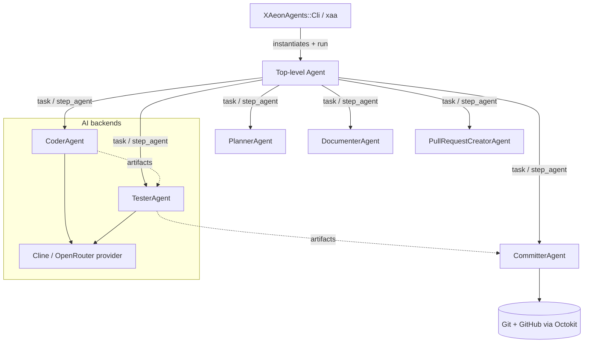

<div align="center">

# x_aeon_agents

**Stop scaling models. Start engineering your AI agents.**

AI coding agents shouldn't have to reinvent software engineering for every task.

[](https://github.com/Muriel-Salvan/x_aeon_agents/actions/workflows/continuous_integration.yml)
[](https://codecov.io/gh/Muriel-Salvan/x_aeon_agents)
[](https://github.com/Muriel-Salvan/x_aeon_agents/stargazers)
[](LICENSE)
[](https://rubygems.org/gems/x_aeon_agents)
[](https://rubygems.org/gems/x_aeon_agents)

</div>

`x_aeon_agents` turns coding agents into participants in **explicit, repeatable software-engineering
processes**. Instead of hoping a model figures out how to develop software on the fly, you engineer the
process: defined responsibilities, deterministic orchestration, artifacts with contracts, and enforced
quality gates.

The result is better software development from the models you already have — including inexpensive ones.

**What you get**

- 🧩 **Composable agents** specialized by development responsibility — planning, coding, testing, reviewing,
  documenting, delivering.
- 🔗 **Explicit workflows** with defined steps and artifact contracts, instead of one ever-growing prompt.
- 🧪 **Engineering practices built in** — tests, validation and documentation are steps of the process, not
  optional suggestions.
- 💾 **Resumable, reproducible runs** — session ids, bounded runs, inspectable artifacts.
- 🛠️ **Ready-to-use workflows** through the `xaa` CLI, or as a Ruby library in your own code.
- 📚 **Reusable skills** that package agent instructions and can be installed into other coding agents.

[Read the engineering case](https://blog.x-aeon.com/2026/11/23/stop-scaling-models-start-engineering-your-ai-agents/) ·
[See the benchmarks](docs/benchmarks.md) ·
[Quick start](#quick-start)

## Table of contents

- [Why engineer your agents?](#why-engineer-your-agents)
- [Does it make a difference?](#does-it-make-a-difference)
- [Features](#features)
  - [Ready-to-use workflows](#ready-to-use-workflows)
  - [Framework capabilities](#framework-capabilities)
- [Quick start](#quick-start)
  - [Install](#install)
  - [Configure](#configure)
  - [First commands](#first-commands)
  - [Credentials and side effects](#credentials-and-side-effects)
- [Requirements](#requirements)
- [How it works](#how-it-works)
  - [Layers](#layers)
  - [Agents, steps and artifacts](#agents-steps-and-artifacts)
  - [Workflow example](#workflow-example)
- [Who is this for?](#who-is-this-for)
  - [What it is not](#what-it-is-not)
- [Extending the ecosystem](#extending-the-ecosystem)
- [Public API](#public-api)
  - [Command line](#command-line)
  - [Ruby library](#ruby-library)
- [Contributing](#contributing)
- [Development](#development)
- [Documentation](#documentation)
- [License](#license)

## Why engineer your agents?

Software development is not only a matter of intelligence. A large part of it is process: compilers,
linters, tests, code review, CI, architectural rules. We don't ask human developers to remember every rule
and personally guarantee every quality requirement — we build processes that enforce them.

Coding agents usually get none of that. You give a model a task and it decides, at every run, whether to
plan, whether to test, whether to document, and whether to commit. When it forgets something, nothing tells
you.

| | One powerful agent | Engineered workflow |
| --- | --- | --- |
| **Process** | Decided by the model at every run | Written once, executed every run |
| **Responsibilities** | Everything at once | Specialized agents |
| **Context** | One growing conversation | Named artifacts with contracts |
| **Quality** | Whatever the model remembers | Steps in the process: tests, validation, review |
| **Failure** | Silent: plausible output, missing work | Explicit: failing gate or missing artifact |
| **Cost** | Model must be good at everything | Model must be good at one step |

The engineered side is not "more agents". It is **a written process executed by agents**:

1. **Separation of responsibilities.** Each agent has one remit. Narrow remits mean shorter instructions,
   more reliable prompts, and attributable failures.
2. **Explicit interfaces.** Agents exchange named artifacts with declared contracts — a plan, a diff, a test
   report — instead of sharing an ever-growing conversation. Artifacts are inspectable, resumable, and can
   be reviewed by a human.
3. **Quality engineered into the workflow.** Tests, validation, review and documentation are steps of the
   process. If a step can be enforced by a tool, it is enforced by a tool.

And it is not about maximizing the number of agents: splitting work has a cost. You add an agent when it
buys isolation, a contract, or a quality gate.

Deeper read: [workflow design](docs/workflow-design.md) ·
[Stop Scaling Models. Start Engineering Your AI Agents.](https://blog.x-aeon.com/2026/11/23/stop-scaling-models-start-engineering-your-ai-agents/)

## Does it make a difference?

The approach is benchmarked in a separate, inspectable harness:
[**agentic-dev-bench**](https://github.com/Muriel-Salvan/agentic-dev-bench). Each scenario pins a public
repository to a commit, creates a GitHub sandbox with an issue, runs an agent through a Harbor/Docker
adapter, and grades the result.

First experiment — the feature request was made on **this repository itself**
(`Muriel-Salvan/x_aeon_agents`, commit `agentic_dev_bench_test`), and run with the **same inexpensive model**
(`nvidia/nemotron-3.5-lightning-free`) in two different setups:

| Configuration | Outcome | Time | Delivered |
| --- | --- | --- | --- |
| Conventional `cline-cli` agent | **Failed** | ≈ 98 min, 208 steps | No completed implementation, no Pull Request |
| `x_aeon_agents` workflow | **Completed** | ≈ 24 min | Production code, tests, documentation and a Pull Request — 2 commits, 8 files |

The model was identical. The difference was the engineering around it.

Caveats, stated plainly: this is **one scenario**, with **one run per configuration**. It is an existence
proof, not a ranking, and it is reported as such.

Methodology, verification, raw metrics and how to reproduce or contribute a scenario:
[docs/benchmarks.md](docs/benchmarks.md) ·
[agentic-dev-bench](https://github.com/Muriel-Salvan/agentic-dev-bench)

## Features

### Ready-to-use workflows

Every workflow is a `xaa` command, run from inside your repository.

| Workflow | What it accomplishes |
| --- | --- |
| `xaa implement-issue <number>` | Reads a GitHub issue and its comments, implements it, commits and opens a Pull Request |
| `xaa implement "<requirements>"` | Implements free-form requirements through planning, coding and testing; optionally commits and opens a Pull Request |
| `xaa review-comments [pr_number]` | Reads review comments addressed to the agent, fixes the code and replies to each thread |
| `xaa commit` | Generates a meaningful commit message for staged changes (staging strategy: `all`, `if_empty`, `none`) |
| `xaa create-pr` | Pushes the branch and opens a Pull Request with an AI-written description |
| `xaa start-task` | Creates a feature branch and a git worktree, pushes it upstream, and runs your `on_open_worktree` hook |
| `xaa interpret-diffs [base]` | Summarizes the working-tree changes and the intent behind them |
| `xaa generate-readme` | Regenerates a project README from the codebase, section by section |
| `xaa generate-skills` / `xaa install-skills` | Generates skill files from ERB templates, and installs skills with their dependencies |
| `xaa prompt "<text>"` | Sends a one-shot prompt to the AI backend |

### Framework capabilities

- 🧩 **Composable orchestration** — top-level agents decompose a job into steps and delegate them to
  specialized child agents.
- 🔗 **Artifact contracts** — every input and output is a named artifact with a declared type, instead of
  conversation state.
- 💾 **Resumable execution** — a global `--session-id` resumes a workflow; artifacts and traces live in a
  per-session directory.
- 🔐 **Configurable models and providers** — per-agent model selection, an `.x_aeon_agents.rb` config DSL,
  and a Cline/OpenRouter provider through RubyLLM.
- 📚 **Reusable skills** — agent instructions as Markdown, generated from ERB templates when you need them
  DRY.
- 👀 **Human in the loop** — generated content (commit messages, plans, PR descriptions) can be opened for
  review before the workflow continues, or auto-accepted with `--no-interactive`.
- 🧱 **Bounded runs** — timeouts, retry budgets and tool restrictions are defaults, not afterthoughts.
- 🪝 **Project hooks** — `setup_project`, `test_project_cmd` and `on_open_worktree` let worktrees, tests and
  editors follow your project conventions.
- 📦 **Reusable library** — the same agents are available programmatically from Ruby.

## Quick start

### Install

```bash
gem install x_aeon_agents
```

Or add it to your project's `Gemfile`:

```ruby
gem 'x_aeon_agents'
```

```bash
bundle install
```

The `xaa` executable is installed alongside the gem. See [Requirements](#requirements) for what must be
present on your machine.

### Configure

Export the credentials you need — the CLI and the library read them automatically:

```bash
export OPENROUTER_API_KEY="sk-or-..."   # powers the AI agents
export GITHUB_TOKEN="ghp_..."           # only for workflows that talk to GitHub
```

For finer control, create an optional `.x_aeon_agents.rb` file in your home directory
(`~/.x_aeon_agents.rb`, global) or in the project directory (project-level). It is evaluated at the start of
every `xaa` command and lets you retrieve secrets from custom sources, define your project's setup and test
commands, hook into the worktree lifecycle, and tune any agent class:

```ruby
debug true

openrouter_api_key { File.read('/path/to/my/key').strip }

test_project_cmd 'bundle exec rspec --format=documentation'

configure_agent(:CoderAgent) do
  { model: 'deepseek/deepseek-v4-flash' }
end
```

Full DSL reference: [docs/configuration.md](docs/configuration.md) ·
[example file](.x_aeon_agents.example.rb)

### First commands

```bash
# Check the installation
xaa version

# Ask a one-off question to the configured backend
xaa prompt "Summarize the purpose of this repository"

# Commit staged changes with an AI-generated message
xaa commit

# Implement a GitHub issue and open a Pull Request
xaa implement-issue 42
```

Every command documents its options: `xaa help <command>`.

### Credentials and side effects

Not every workflow needs the same credentials — and several of them **modify your repository or your
GitHub project**. Read the right-hand columns before the first run.

| Command | Credentials | Side effects |
| --- | --- | --- |
| `xaa version` | — | None |
| `xaa prompt`, `xaa interpret-diffs` | Model key | None |
| `xaa commit` | Model key | **Creates a git commit** |
| `xaa generate-readme` | Model key | **Rewrites the README file** |
| `xaa generate-skills` | — | Writes generated skills to the output directory |
| `xaa install-skills` | Network access | Writes skills into your agent's skill directory |
| `xaa start-task` | Git push credentials | **Creates a branch and a worktree, pushes upstream** |
| `xaa create-pr` | Model key, `GITHUB_TOKEN`, `gh`, git push credentials | **Pushes the branch and opens or updates a Pull Request** |
| `xaa implement` | Model key (plus GitHub credentials with `--pr-base`) | **Modifies files**, commits with `--commit`, opens a Pull Request with `--pr-base` |
| `xaa implement-issue` | Model key, `GITHUB_TOKEN`, `gh`, git push credentials | **Modifies files, commits, pushes and opens a Pull Request** |
| `xaa review-comments` | Model key, `GITHUB_TOKEN`, `gh`, git push credentials | **Modifies files, commits, pushes and replies to review threads** |

*Model key* = `OPENROUTER_API_KEY`, or `CLINE_API_KEY` when the Cline backend is used.

## Requirements

- **Operating system** — any platform supported by Ruby (Linux, macOS, Windows). Linux environments tend to
  behave best with coding agents.
- **Ruby** `>= 3.1`, with RubyGems/Bundler.
- **Git** command-line client in `PATH` — the agents operate on repositories, branches, worktrees and
  commits.
- **A Git repository** — `xaa` commands run from inside one.
- **Network access** — to reach the model provider and GitHub APIs.
- **`OPENROUTER_API_KEY`** — an OpenRouter API key, used by RubyLLM to power the AI agents.
- **`CLINE_API_KEY`** *(optional)* — only when driving the Cline agent integration instead of OpenRouter.
- **`GITHUB_TOKEN`** *(optional for local-only workflows)* — a GitHub personal access token used by Octokit
  for the workflows that read issues or review comments and create Pull Requests.
- **GitHub CLI (`gh`)** *(optional for local-only workflows)* — installed and authenticated for the Pull
  Request and review-comment workflows.

Each secret can alternatively be retrieved by custom code declared in the
[configuration file](docs/configuration.md#secret-retrieval-blocks).

## How it works

`x_aeon_agents` is a Ruby gem organized in three layers: a **CLI**, a set of **orchestrating agents**, and
a shared **core** that glues them together.

### Layers

```text
bin/xaa → XAeonAgents::Cli (Thor) → Agents::* → Config, Helpers, GenHelpers, Providers, Logger
```

- Every CLI command maps 1:1 to an agent class. The CLI only parses arguments, loads configuration and
  instantiates the workflow.
- Agents are built on [`composable_agents`](https://github.com/Muriel-Salvan/composable_agents): orchestrators
  run commands and coordinate child agents, while AI agents execute prompts against a provider.
- A shared `AgentDefaults` mixin gives every agent its pipeline primitives, artifact contracts, resume
  support, session directory, bounded Cline run options and tool restrictions.
- Configuration, secrets, Git/GitHub access and diff extraction are centralized, so agents never read the
  environment or shell out on their own terms.

### Agents, steps and artifacts

A top-level agent decomposes its job into **steps** and delegates each one to a **child agent**. State moves
through **named artifacts** (a plan, a diff, a test report, a commit message) that are declared with input
and output contracts — not through an accumulating conversation. That is what makes a run inspectable,
resumable with `--session-id`, and reviewable by a human.

### Workflow example

`DeveloperAgent` chains planning, coding, testing, committing, documenting and delivery:



The chain is illustrative, not a fixed pipeline: the top-level agent decides which steps run and whether a
step must be retried. The contracts of the steps are what stay stable.

More detail: [architecture](docs/architecture.md) · [configuration](docs/configuration.md) ·
[workflow design](docs/workflow-design.md)

## Who is this for?

- **Developers using AI coding agents** who want development tasks to follow a repeatable process instead of
  a different improvisation every time.
- **Teams working with inexpensive or self-hosted LLMs** who would rather improve results through
  orchestration than pay for a frontier model on every task.
- **Agent developers** who want to build specialized, reusable workflows — with contracts and gates — rather
  than a single monolithic agent.
- **Open-source contributors** interested in building and sharing software-engineering workflows, skills and
  benchmarks.

### What it is not

`x_aeon_agents` is not another general-purpose autonomous coding agent. It is an engineering framework and a
collection of workflows that structure *how* coding agents perform development tasks. You decide when to run
them, on which branch, and with which model.

## Extending the ecosystem

The framework is meant to be extended, and most extensions do not require being a Ruby expert:

- **Design a workflow** — decide the responsibilities, the artifacts crossing each boundary, and the quality
  gates; then implement the orchestrator. See [workflow design](docs/workflow-design.md).
- **Write a skill** — package a process as Markdown, generate it from an ERB template, and let agents follow
  it. See [skill authoring](docs/skill-authoring.md).
- **Plug a model or a tool** — assign models per agent class in the configuration, or add a provider under
  `lib/x_aeon_agents/providers/`. See [configuration](docs/configuration.md).
- **Extend the benchmarks** — add paired scenarios to
  [agentic-dev-bench](https://github.com/Muriel-Salvan/agentic-dev-bench) so that claims stay testable. See
  [benchmarks](docs/benchmarks.md).

## Public API

The public surface is the `xaa` executable and the Ruby methods tagged with YARD's `Public API` group.
Everything else is internal and may change.

### Command line

`bin/xaa` boots the gem and dispatches to `XAeonAgents::Cli`. Run it from inside a Git repository.

- **Global options**: `--session-id` (resume a workflow), `--debug`, `--interactive` / `--no-interactive`.
- **Commands**: each one is listed with its purpose in [Ready-to-use workflows](#ready-to-use-workflows).
- **Per-command options**: `xaa help <command>` is authoritative (for example
  `xaa help implement-issue`).
- **References**: [`bin/xaa`](bin/xaa) ·
  [RubyDoc — XAeonAgents::Cli](https://www.rubydoc.info/gems/x-aeon_agents/XAeonAgents/Cli)

### Ruby library

```ruby
require 'x_aeon_agents'

XAeonAgents::Config.configure(
  openrouter_api_key: ENV['OPENROUTER_API_KEY'],
  github_token: ENV['GITHUB_TOKEN']
)

# Trigger an agent programmatically
XAeonAgents::Agents::CommitterAgent.new.run
```

Full references:

- [RubyDoc — x_aeon_agents](https://www.rubydoc.info/gems/x-aeon_agents) — every public method.
- [configuration](docs/configuration.md) — the `.x_aeon_agents.rb` DSL, `XAeonAgents::Config` and
  `XAeonAgents::Logger`.
- [skill authoring](docs/skill-authoring.md#genhelpers-reference) — `XAeonAgents::GenHelpers` and the ERB
  templating helpers.

## Contributing

Contributions are welcome — and not only in Ruby:

- **Create or improve a workflow** — design the process, then the agents.
- **Write or improve a skill** — plain Markdown, generated from a template.
- **Expand the benchmarks** — paired scenarios that keep the claims honest.
- **Integrate models and tools** — providers, tool constraints, cost reporting.
- **Improve documentation** — tutorials, field reports, corrections.
- **Contribute code** — bug fixes, refactors, specs.

Start with [CONTRIBUTING.md](CONTRIBUTING.md), which covers the working rules, the development environment,
the quality gates and the release process. If you are unsure where your idea fits, open an issue and ask:
workflows are architecture, and a written design is often worth more than a patch.

## Development

```bash
git clone https://github.com/Muriel-Salvan/x_aeon_agents.git
cd x_aeon_agents
bundle install

bundle exec rspec --format documentation   # tests (coverage gate enforced)
bundle exec rubocop                        # style
bundle exec ruby bin/xaa --help            # run the CLI from the sources
```

The full development guide — coverage threshold, YARD requirements, skill regeneration, worktree policy,
conventional commits and the release pipeline — lives in [CONTRIBUTING.md](CONTRIBUTING.md).

## Documentation

| Resource | What it covers |
| --- | --- |
| [Architecture](docs/architecture.md) | Layers, agent kinds, artifacts, orchestration, providers, testing seams |
| [Workflow design](docs/workflow-design.md) | Why engineer agents, the three principles, how to design and add a workflow |
| [Configuration](docs/configuration.md) | `.x_aeon_agents.rb` DSL, `XAeonAgents::Config`, `XAeonAgents::Logger` |
| [Skill authoring](docs/skill-authoring.md) | Skill conventions, ERB templating, `XAeonAgents::GenHelpers` |
| [Benchmarks](docs/benchmarks.md) | Harness, first experiment, methodology, limitations, how to contribute scenarios |
| [Contributing](CONTRIBUTING.md) | Contribution paths, environment, gates, commits, releases |
| [RubyDoc.info](https://www.rubydoc.info/gems/x-aeon_agents) | Generated API reference |
| [CHANGELOG](CHANGELOG.md) | Release history |
| [agentic-dev-bench](https://github.com/Muriel-Salvan/agentic-dev-bench) | The benchmark harness, scenarios and run reports |

## License

This project is distributed under the **BSD-3-Clause** license. See [LICENSE](LICENSE) for the full terms and
copyright information.

