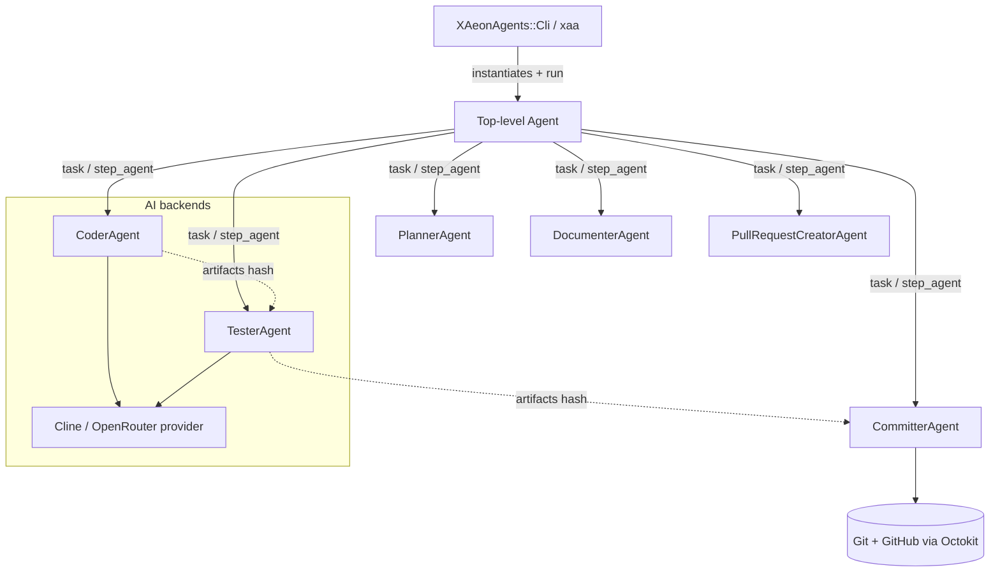

# Architecture

This page explains how the gem is built. It is meant for contributors and for agent developers who want
to add workflows; the README keeps only the conceptual overview.

- [Three layers](#three-layers)
- [Entry point](#entry-point)
- [Agent kinds](#agent-kinds)
- [`AgentDefaults`: what every agent gets for free](#agentdefaults-what-every-agent-gets-for-free)
- [Artifacts and contracts](#artifacts-and-contracts)
- [Orchestration](#orchestration)
- [Providers](#providers)
- [Helpers](#helpers)
- [Configuration](#configuration)
- [Testing seams](#testing-seams)

## Three layers

```text
bin/xaa                      executable
  └── XAeonAgents::Cli       Thor command-line interface (one command -> one agent)
        └── Agents::*        orchestration and AI agents
              └── core       Config, Helpers, GenHelpers, Providers, Logger
```

- **CLI** — argument parsing, global options, config loading, exit codes.
- **Agents** — the actual workflows: orchestrators that decompose a job into steps and LLM agents that
  execute those steps.
- **Core** — the plumbing shared by every agent: configuration, shell/Git/GitHub helpers, skill template
  helpers, the LLM provider and the logger.

Source layout:

```text
lib/x_aeon_agents.rb          Zeitwerk setup and module-level helpers
lib/x_aeon_agents/
  cli.rb                      Thor CLI definition
  config.rb, config_dsl.rb    Configuration singleton and the .x_aeon_agents.rb DSL
  agent_defaults.rb           Mixin applied to every agent
  helpers.rb                  Shell, Git, GitHub, diffs, interactive reviews
  logger.rb                   Status-aware logger
  gen_helpers.rb              ERB helpers for skill generation
  agents/                     One class per capability (and readme/ section generators)
  providers/cline.rb          RubyLLM provider for the Cline API
bin/xaa                       CLI executable
skills.src/                   ERB skill templates (source of truth)
skills/                       Generated skills
spec/                         RSpec suite (scenarios, helpers, stubs)
```

## Entry point

- The `bin/xaa` executable boots [Zeitwerk](https://github.com/fxn/zeitwerk) auto-loading and calls
  `XAeonAgents::Cli.start(ARGV)`.
- The CLI ([`lib/x_aeon_agents/cli.rb`](../lib/x_aeon_agents/cli.rb)) is a
  [Thor](https://github.com/rails/thor) application: every sub-command (`commit`, `create-pr`,
  `review-comments`, `implement-issue`, `generate-readme`…) maps **1:1** to an agent class.
- On startup it loads the optional `.x_aeon_agents.rb` configuration (home directory, then project
  directory, then `X_AEON_AGENTS_CONFIG`), and explicit CLI flags (`--session-id`, `--debug`,
  `--interactive`) override everything. See [configuration](configuration.md).

Because the CLI is a thin dispatcher, a workflow is testable without going through Thor, and a new
workflow usually means "a new agent class + one command that instantiates it".

## Agent kinds

Every capability is an `Agents::*Agent` class built on `composable_agents`:

- **`ComposableAgents::Agent`** — pure orchestrators. They run shell commands and coordinate child
  agents, without talking to an LLM themselves. `ReadmeGeneratorAgent` and `DeveloperAgent` are examples.
- **`ComposableAgents::AiAgents::Agent`** — LLM-driven agents backed by RubyLLM and a provider.
- **`ComposableAgents::Cline::Agent`** — LLM-driven agents executed through the Cline CLI, which gives the
  agent file-editing and command-execution tools inside the workspace.

The distinction matters for cost and safety: an orchestrator is deterministic and free, while a Cline
agent is a model with tools and therefore needs constraints and a bounded run.

## `AgentDefaults`: what every agent gets for free

Every agent class `prepend`s [`AgentDefaults`](../lib/x_aeon_agents/agent_defaults.rb), which provides:

- **Pipeline primitives** — `new_agent`, `task`, `step` and `step_agent` to build multi-step pipelines.
- **Framework wiring** — `setup_composable_agents`, `setup_ai_agents` and `setup_cline` configure the
  underlying frameworks, and inject per-class defaults (overridable with `configure_agent` in the config
  DSL). For Cline agents it also injects `timeout: 600` and `retries: 5` CLI options so that every run is
  bounded; explicitly configured options supersede them.
- **Tool restriction** — it disables the Cline tools that X-Aeon agents don't use (agent spawning and team
  management), and `ask_question` in non-interactive mode, merging them without duplicates with whatever
  `configure_global` adds.
- **Contracts and resume** — it enforces input/output artifact contracts and adds resume support (the
  `ArtifactContract` and `Resumable` mixins).
- **Session directory** — each agent gets a per-session directory under `Config.data_dir/sessions/<id>`,
  which is where artifacts, temporary files, debug traces and Git diffs live.
- **Logging and metrics** — the shared logger, token usage accounting and the agent's reported status.

Because those behaviors are centralized, an agent class is usually just: an objective, a set of
constraints, artifact contracts, and a `run` method that composes steps.

## Artifacts and contracts

Agents do not pass context through an ever-growing conversation. They exchange **named artifacts**
written to files, referenced in code with `artifact_ref(:name)`:

- **Output contracts** declare what an agent produces: a description, a type (`:markdown`, `:text`,
  `:json`…) and whether it is optional.
- **Input contracts** declare what an agent consumes, so a missing or malformed input fails early and
  explicitly instead of producing a plausible but wrong result.
- The runtime keeps the artifacts in a shared `@artifacts` hash per session, and gives each agent access
  to the files it is allowed to read or write.

This is the mechanism behind "explicit interfaces": a downstream agent receives a contract, not the
transcript of everything the upstream agents said.

## Orchestration

A top-level agent decomposes its job into **steps**, delegating each one to a child agent. State flows
through the shared artifacts hash. For example, `DeveloperAgent` chains
`PlannerAgent` → `CoderAgent` → `TesterAgent` → `CommitterAgent` / `DocumenterAgent` →
`PullRequestCreatorAgent`:



The chain is not a fixed pipeline: the top-level agent decides which steps run, in which order, and
whether a step must be retried. What is fixed is the **contract** of each step — which is what makes the
workflow reviewable.

Design rules for new workflows are in [workflow design](workflow-design.md).

## Providers

LLM calls flow through [`Providers::Cline`](../lib/x_aeon_agents/providers/cline.rb), an OpenAI-compatible
[RubyLLM](https://github.com/crmne/ruby_llm) provider targeting the Cline API
(`https://api.cline.bot/api/v1`). It parses responses including thinking blocks, tool calls and token
usage, so costs and reasoning are observable.

Model selection is per agent class, through `configure_agent` — see [configuration](configuration.md).

## Helpers

[`XAeonAgents::Helpers`](../lib/x_aeon_agents/helpers.rb) centralizes the plumbing used by every agent:

- real-time command execution (`run_cmd`) with an expected exit status;
- cached Git and GitHub (Octokit) clients, and diff extraction (`git_diff_cached`, `artifact_files_diffs`);
- interactive content review: a generated artifact is opened in a temporary file via Launchy so a human
  can approve or edit it before the workflow continues.

## Configuration

Configuration is resolved from four layers (explicit setters, environment, config DSL, CLI flags) and is
documented in [configuration.md](configuration.md). The important architectural point is that **agents
never read the environment directly**: they read `XAeonAgents::Config`, which makes tests deterministic
and secrets swappable.

## Testing seams

The suite never calls a provider. AI agents are stubbed by prepending a module on the agent base classes,
so the full agent graph runs with mocked artifacts; shell commands and Git remotes are stubbed through
`stub_command` and `mock_git_remotes`. See [CONTRIBUTING.md](../CONTRIBUTING.md#tests) for the helpers and
conventions.

